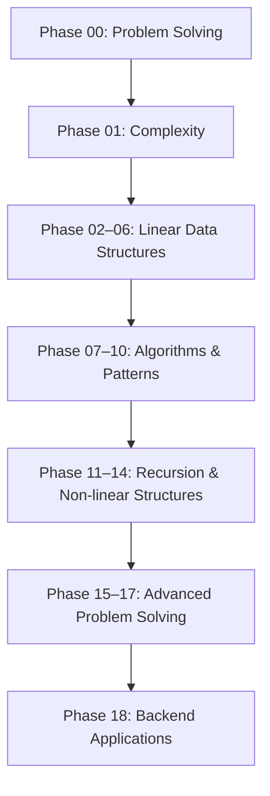

# DSA Backend Lab

> **Lộ trình học Data Structures & Algorithms từ nền tảng đến ứng dụng trong Backend Engineering**  
> Ngôn ngữ: **JavaScript → TypeScript**  · Định hướng: **Backend Engineering → AI Engineering**

## 1. Tổng quan dự án

**DSA Backend Lab** là repository ghi lại quá trình học Data Structures & Algorithms (DSA) theo hướng hiểu bản chất và ứng dụng thực tế, thay vì ghi nhớ lời giải LeetCode hay các mẫu thuật toán.

Mục tiêu là có khả năng:

- Đọc và phân tích **Problem, Input, Output, Constraints, Edge Cases**.
- Đề xuất cách giải ban đầu (**Brute Force**) và giải thích điểm hạn chế.
- Chọn **Data Structure** và **Algorithm** phù hợp với yêu cầu.
- Phân tích **Time Complexity**, **Space Complexity** và các **Trade-offs**.
- Giải thích vì sao một giải pháp phù hợp hoặc không phù hợp với tình huống cụ thể.
- Liên hệ kiến thức DSA với các bài toán Backend như caching, rate limiting, scheduling và searching.

## 2. Sơ đồ lộ trình



> Các phase thể hiện **thứ tự học dự kiến**, không có nghĩa mọi kỹ năng trong phase trước phải hoàn hảo mới được tiếp tục. Kiến thức sẽ được ôn lại qua bài tập và ứng dụng ở những phase sau.

## 3. Roadmap chi tiết

| Phase | Chủ đề | Nội dung trọng tâm | Kết quả kỳ vọng |
|---|---|---|---|
| **00** | Problem Solving Fundamentals | Input, Output, Constraints, Edge Cases, Examples, Brute Force, Optimization | Hiểu và diễn giải đúng yêu cầu trước khi code |
| **01** | Complexity Analysis | O(1), O(n), O(n²), O(log n), O(n log n), Time/Space Complexity, Best/Average/Worst Case | Giải thích được chi phí và khả năng mở rộng của lời giải |
| **02** | Arrays | Indexing, Traversal, Insert/Delete, In-place Operations | Hiểu cách truy cập và thao tác trên dữ liệu tuyến tính |
| **03** | Hash Tables | Hashing, Map, Set, Collision, Lookup, Frequency Counting | Biết khi nào nên dùng tra cứu theo khóa |
| **04** | Linked Lists | Node, Reference, Singly/Doubly Linked List | Hiểu cấu trúc dữ liệu liên kết và trade-off |
| **05** | Stacks | LIFO, Push/Pop, Stack Applications | Nhận diện bài toán cần xử lý theo thứ tự ngược |
| **06** | Queues | FIFO, Circular Queue, Deque | Hiểu mô hình hàng đợi và ứng dụng xử lý tác vụ |
| **07** | Searching | Linear Search, Binary Search | So sánh chiến lược tìm kiếm và điều kiện áp dụng |
| **08** | Sorting | Bubble, Insertion, Merge, Quick Sort | Giải thích cơ chế, độ phức tạp và trade-off của thuật toán sắp xếp |
| **09** | Two Pointers | Left/Right, Fast/Slow | Nhận diện các bài toán có thể giảm số lần duyệt |
| **10** | Sliding Window | Fixed/Variable Window | Xử lý hiệu quả những đoạn dữ liệu liên tiếp |
| **11** | Recursion | Base Case, Call Stack, Recursive Thinking | Biết phân rã bài toán và theo dõi luồng gọi hàm |
| **12** | Trees | Binary Tree, BST, Traversal | Xử lý cấu trúc phân cấp |
| **13** | Heaps | Min/Max Heap, Priority Queue | Xử lý phần tử theo mức độ ưu tiên |
| **14** | Graphs | Graph Representation, BFS, DFS, Shortest Path | Mô hình hóa và duyệt các quan hệ/kết nối |
| **15** | Greedy | Local Choice, Correctness Reasoning | Nhận biết khi nào lựa chọn cục bộ có thể dẫn đến lời giải đúng |
| **16** | Backtracking | State Space, Pruning | Khám phá và loại bỏ phương án có hệ thống |
| **17** | Dynamic Programming | Memoization, Tabulation, State Transition | Giải bài toán có subproblem trùng lặp |
| **18** | Backend Applications | LRU Cache, Rate Limiter, Task Scheduler, Leaderboard, Search | Vận dụng DSA vào các thành phần Backend thực tế |

## 4. Phương pháp học và tiêu chí hoàn thành

Mỗi concept được học theo quy trình:

```text
Problem → Mental Model → Small Example → Prediction
        → Implementation → Code Explanation
        → Complexity / Alternatives (khi phù hợp)
        → Backend Application → Exercise
        → Review → Feynman Checkpoint → README → Git Commit
```

**Nguyên tắc:**

1. Chỉ học **một concept nhỏ tại một thời điểm**.
2. Dùng **JavaScript** để hiểu cơ chế; chuyển sang **TypeScript** khi phù hợp.
3. Tự dự đoán, giải thích, viết pseudocode và thử giải trước khi xem lời giải hoàn chỉnh.
4. Giải thích được *vì sao*, không chỉ *viết như thế nào*.
5. Checkpoint được đánh giá khách quan theo thang **10 điểm**; cần đạt **tối thiểu 8/10** để hoàn thành concept.
6. Chỉ sau khi đạt checkpoint mới tổng hợp **README** của concept và tạo **Git commit** tương ứng.
7. Không ép phân tích Big O hay thuật toán khi concept hiện tại chưa đề cập đến những nội dung đó.

## 5. Cấu trúc repository

**Cấu trúc mục tiêu**:

```text
dsa-backend-lab/
├── README.md                         # Tổng quan và roadmap
├── package.json
├── .gitignore
├── docs/
│   ├── learning-roadmap.md           # Chi tiết roadmap (nếu cần tách riêng)
├── src/
│   ├── phase-00-problem-solving/
│   │   ├── 01-input/
│   │   ├── 02-output/
│   │   └── 03-constraints/
│   ├── phase-01-complexity/
│   ├── phase-02-arrays/
│   ├── ...
│   └── phase-17-dynamic-programming/
├── backend-applications/
│   ├── lru-cache/
│   ├── rate-limiter/
│   ├── task-scheduler/
│   ├── leaderboard/
│   └── search-system/
└── tests/
```

Mỗi concept có thể gồm:

```text
01-example-concept/
├── README.md             # Mental model, sơ đồ, kiến thức đã hiểu, checkpoint
├── examples.js           # Ví dụ minh họa nhỏ
├── solution.js           # Bài giải khi đã đến bước implementation
└── solution.test.js      # Kiểm thử khi cần thiết
```

Không bắt buộc mọi bài phải có đủ bốn file. Chỉ tạo những file thực sự phục vụ nội dung đã học.

## 6. Quy ước Git

Mỗi commit nên thể hiện một bước tiến có ý nghĩa:

```bash
git commit -m "learn: understand input and input size"
git commit -m "learn: understand problem output"
git commit -m "learn: understand input constraints"
```

Với ứng dụng Backend hoặc kiểm thử:

```bash
git commit -m "feat: implement lru cache"
git commit -m "test: cover cache eviction behavior"
```

## 7. Định nghĩa hoàn thành

Một concept được đánh dấu **Hoàn thành** khi có đủ các bằng chứng phù hợp:

- Có thể tự giải thích khái niệm bằng lời của mình.
- Xác định được vấn đề và kết quả cần đạt.
- Giải thích được ví dụ/code đã học, nếu bài có code.
- Hiểu các giới hạn, lựa chọn hoặc trade-off đã được giới thiệu trong bài.
- Đạt **Feynman Checkpoint ≥ 8/10**.
- Có tài liệu tổng kết và commit ghi nhận tiến độ.

---

**Nguyên tắc cốt lõi:** *Understand the problem → Reason about the solution → Implement → Explain → Apply.*
